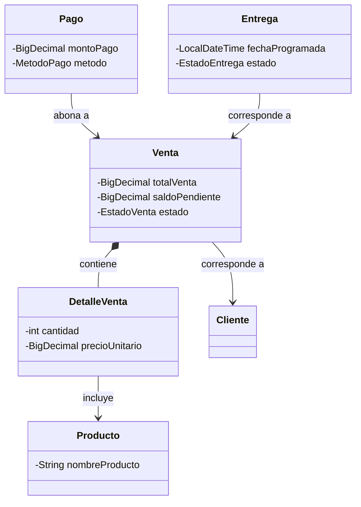
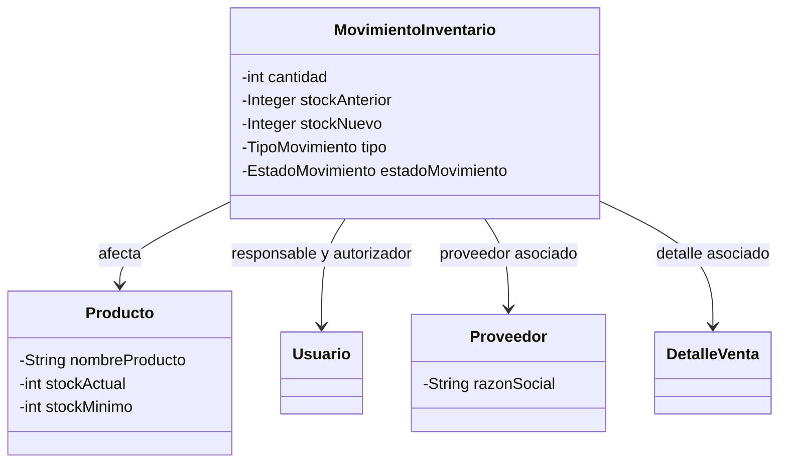
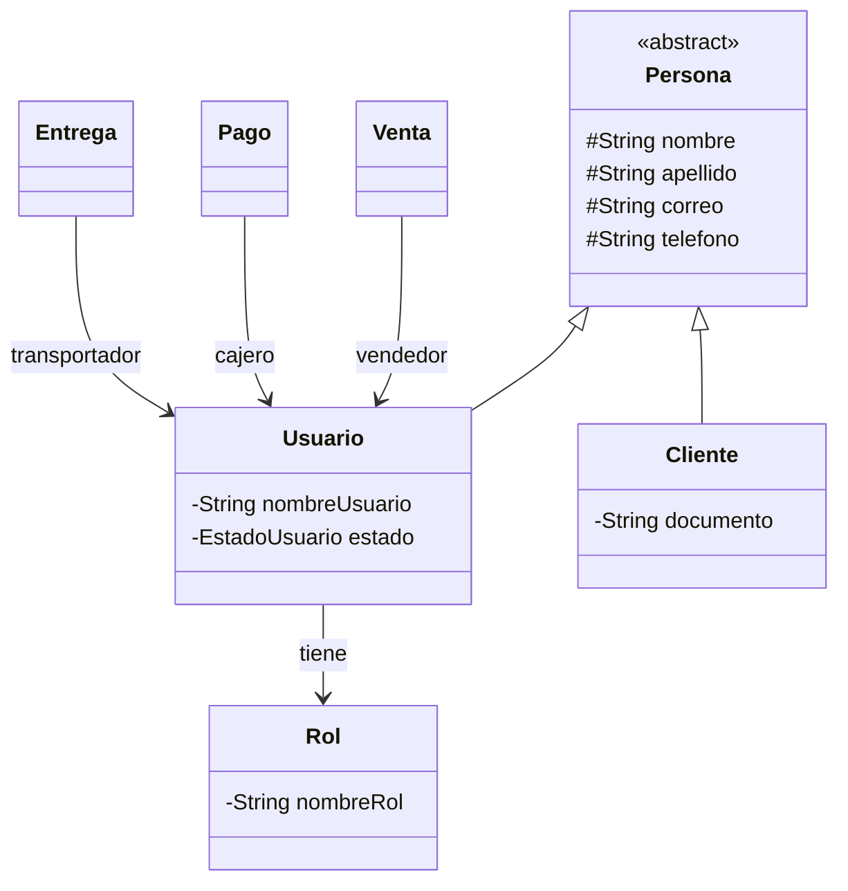

# Mobilia Haus

Mobilia Haus es una aplicación de escritorio desarrollada como proyecto integrador para gestionar la operación de un negocio de muebles. Reúne el catálogo, el inventario, las ventas, los pagos y las entregas en un solo lugar. Su propósito es que el equipo pueda consultar qué productos tiene disponibles, cuánto queda por cobrar y en qué estado está cada entrega.

## Avance actual

Mobilia Haus sigue en desarrollo. Esta sección describe los módulos y flujos que se han trabajado hasta el momento. A medida que se amplíen o completen las funcionalidades, se actualizará esta documentación.

| Módulo | Funcionalidad trabajada hasta ahora |
| --- | --- |
| Catálogo de productos | Administrar las fichas de los muebles, sus precios y el nivel mínimo de existencias de cada referencia. |
| Inventario y Kardex | Solicitar entradas, salidas y ajustes de inventario, consultar su historial y revisar los productos con existencias bajas. |
| Ventas y pagos | Registrar una venta con sus productos y cantidades, consultar el saldo pendiente, registrar pagos y generar un comprobante de texto. |
| Entregas | Programar el despacho de una venta, asignar un transportador y actualizar el estado de la entrega. |
| Clientes y proveedores | Mantener los datos de las personas que compran y de los proveedores asociados a los movimientos de inventario. |
| Usuarios y reportes | Controlar el acceso por rol y consultar indicadores como alertas de stock, movimientos pendientes y entregas activas. |

## Cómo se conectan los módulos en el avance actual

Una venta comienza con la selección del cliente y de los productos. El sistema comprueba las cantidades disponibles y, al registrar la operación, deja constancia de la salida de los productos en el Kardex. A partir de esa misma venta se puede consultar el saldo, registrar pagos y programar el despacho con los datos de la persona que recibirá el pedido.

**El Kardex es el historial de cambios del inventario.** Cada ficha de producto comienza con existencias en cero. Las entradas, salidas y ajustes manuales pasan por una solicitud pendiente y solo afectan las existencias cuando un usuario autorizado los aprueba. El historial permite consultar el motivo, el responsable y, cuando corresponde, las cantidades anterior y posterior al movimiento. Esto permite reconstruir cómo cambió el stock de un producto.

**El acceso depende de las responsabilidades del usuario.** Por ejemplo, aprobar movimientos de inventario y actualizar una entrega son acciones sujetas al rol y a las reglas de cada módulo.

## Organización del sistema

La aplicación sigue una arquitectura MVC con capas de servicio y persistencia. Las pantallas muestran la información y reciben las acciones del usuario. Los controladores coordinan esas acciones con los servicios, donde se aplican reglas como la validación de existencias y la autorización de movimientos. Los DAO se encargan de leer y guardar los datos en PostgreSQL.

El proyecto usa **Java 17**, **Swing** para la interfaz gráfica, **PostgreSQL** para los datos y **Maven** para la compilación.

## Diagrama de clases

Las tres vistas muestran el modelo del proyecto en su estado actual. Algunas clases aparecen en más de una vista porque conectan distintas partes del sistema.

### Venta, pago y entrega

La venta reúne los productos comprados en sus detalles. Cada pago y cada entrega se vinculan con la venta correspondiente.



### Inventario y Kardex

Cada movimiento identifica el producto afectado y el usuario responsable. Según su origen, también puede asociarse a un proveedor o al detalle de una venta.



### Personas, roles y responsabilidades

Cliente y Usuario comparten datos de contacto a través de Persona. El usuario tiene un rol y puede intervenir como vendedor, cajero o transportador, según la operación.



## Puesta en marcha

Se requiere un JDK 17, Maven y una base de datos PostgreSQL con el esquema de Mobilia Haus inicializado. Para usar una conexión propia, configura `db.url`, `db.user` y `db.password` en un archivo local `proyectointegrador/src/main/resources/config.properties`.

Desde la raíz del repositorio, ejecuta en Git Bash:

```bash
cd proyectointegrador
mvn compile exec:java -Dexec.mainClass=com.uniajc.Main
```

La aplicación abre la interfaz gráfica de inicio de sesión.

